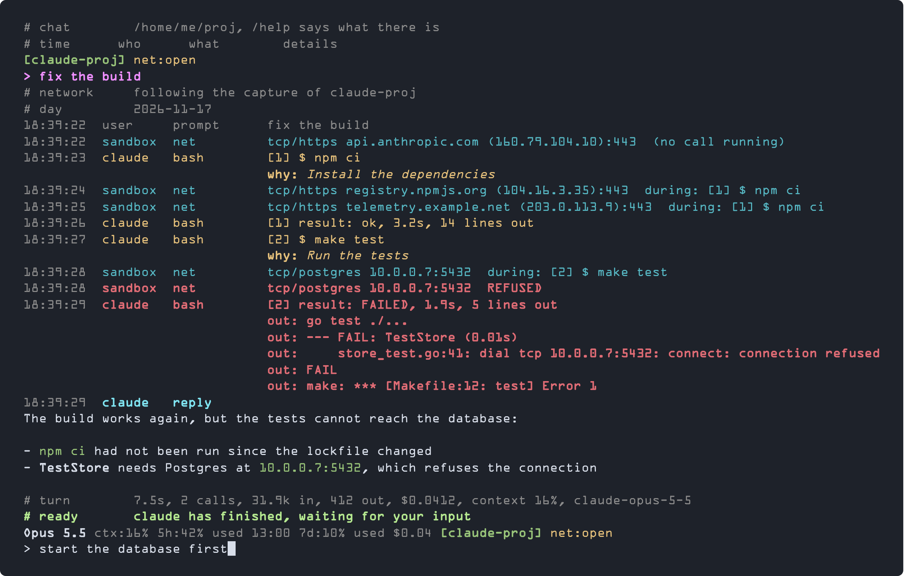

# claude-sandbox

Run [Claude Code](https://claude.com/claude-code) inside a hardened Docker
container, with only the current project mounted. Works from any shell, and
from editors that can launch a custom `claude` program.


What you get:

- **A contained session.** Only the project is mounted, as your user, on a
  read-only root filesystem with all capabilities dropped. Secrets in
  `.env` files read as empty, and Claude's own configuration is read-only.
  On Linux it can run on [gVisor](docs/sandbox.md#gvisor), a kernel of its
  own, instead of the host's.
- **A record of what it did.** Every connection, DNS lookup and process is
  recorded from outside the session, so the session cannot tamper with
  it. Its tool calls come from its own transcript, which the launcher
  copies as it is written and flags when a line is later changed or
  removed. `--trace` shows it all.
- **A check when it ends.** The launcher warns when a session changed a
  file that runs commands on the host, a git hook or a Makefile say.
- **Line mode.** Claude Code with a simpler UI: a prompt, and above it
  what the session does, the network included.
- **Opt-in doors.** An egress filter, the SSH agent and the Docker socket,
  each off until you switch it on.

Contents:

- [Requirements](#requirements), [Install](#install) and [Usage](#usage),
  with the [settings](#settings)
- [What the sandbox does](#what-the-sandbox-does) and its
  [known limits](#known-limits)
- [Reviewing a session](#reviewing-a-session) with `--trace`
- [Line mode](#line-mode), Claude Code without its native UI
- [The image](#the-image) and its features
- [Statusline](#statusline), [Editor integration](#editor-integration)
  and [Tests](#tests)

## Requirements

- Docker (Linux, or Docker Desktop on macOS)
- Python 3.9 or later for the launcher, standard library only
- bash and `jq` on the host if you use the statusline outside the sandbox

## Install

```
git clone https://github.com/smallwat3r/claude-sandbox.git ~/code/claude-sandbox
export PATH="$HOME/code/claude-sandbox/bin:$PATH"
```

Or leave `PATH` alone and symlink the launcher into a directory already on
it, it finds the rest of the checkout from where it really is:

```
ln -s ~/code/claude-sandbox/bin/claude-docker ~/.local/bin/claude-docker
```

## Usage

```
cd ~/code/my-project
claude-docker                       # builds the image on first use
claude-docker -p "summarise this" < notes.txt   # piped, no TTY needed
```

Any other argument is forwarded to `claude`.

The container is the sandbox, so `claude` is started with
`--dangerously-skip-permissions` and does not ask before it uses a tool.
`CLAUDE_DOCKER_ASK=1` has it ask, and a `--permission-mode` of your own is
left as it is. [Known limits](#known-limits) says what a session can reach
without being asked.

The launcher's own options, `claude-docker --help` lists them with the
settings:

```
# What a session gets
claude-docker --add-dir ~/code/api  # mount a second project read-write
claude-docker --add-dir-ro ~/code/lib   # mount reference code read-only
claude-docker --worktree feature-x  # second session on its own git worktree
claude-docker --shell               # bash in the same sandbox, to look around

# The image, see "The image"
claude-docker --rebuild             # clean image rebuild, then exit
claude-docker --prune               # delete all sandbox images but the current one
claude-docker --dockerfile          # print the generated Dockerfile, then exit

# The egress filter, see "The opt-in doors"
claude-docker --net-log             # domains the egress filter denied
claude-docker --net-reload          # restart the egress filter

# What a session did, see "Reviewing a session"
claude-docker --trace               # what the latest session here did
claude-docker --trace list          # this project's sessions, latest first
claude-docker --trace 3fa9 --verbose > trace.txt   # one session, in detail
claude-docker --trace --json | jq 'select(.what == "net")'   # as JSON Lines
claude-docker --trace --only bash,net   # just the commands and the network
claude-docker --trace --failed      # just what went wrong
claude-docker --trace --follow      # what the sessions here do, as they do it

# Claude Code's native UI in place of line mode, see "Line mode"
CLAUDE_DOCKER_LINE_MODE=0 claude-docker  # or in the config file, for every session
```

### Settings

All optional, set in the environment or in [the config file](#the-config-file).
A switch takes `1` for on and `0` for off. Any other value, such as `true`,
stops the launcher instead of quietly leaving a restriction off.

What a session gets:

| Setting | Default | Effect |
| --- | --- | --- |
| `CLAUDE_DOCKER_EXTRA_DIRS=a:b` | none | Extra directories to mount, as repeated `--add-dir` |
| `CLAUDE_DOCKER_EXTRA_DIRS_RO=a:b` | none | The same read-only, as repeated `--add-dir-ro` |
| `CLAUDE_DOCKER_SHARED_DIR=~/scratch` | `~/claude-shared` if it exists | Scratch directory shared between sessions, empty for none |
| `CLAUDE_DOCKER_SHADOW="*.pem:.npmrc"` | none | More file names to hide, on top of the `.env` family |
| `CLAUDE_DOCKER_PROTECT="~/kit:docs"` | none | Paths that are read-only wherever they are mounted |
| `CLAUDE_DOCKER_RW_CONFIG` | `0` | `1` makes the protected parts of `~/.claude` (`settings.json`, `CLAUDE.md`, `hooks`...) writable |
| `CLAUDE_DOCKER_SHARED_HISTORY` | `0` | `1` lets a session see Claude Code's history of every project, not only its own |
| `CLAUDE_DOCKER_CACHE` | `1` | `~/.cache` persists per project. `0` makes it a tmpfs of at most 2g |
| `ANTHROPIC_API_KEY`, `GH_TOKEN` | unset | Passed through when set, `GH_TOKEN` is how `gh` logs in |

The doors, all closed by default:

| Setting | Default | Effect |
| --- | --- | --- |
| `CLAUDE_DOCKER_NET_FILTER` | `0` | `1` allows only the domains in `docker/allowed-domains.txt`, over HTTP, HTTPS and git over SSH |
| `CLAUDE_DOCKER_SSH_AGENT` | `0` | `1` forwards your SSH agent, so git over SSH and `ssh` work with your keys |
| `CLAUDE_DOCKER_CONNECTORS` | `0` | `1` loads the connectors of your claude.ai account (Gmail, Google Drive...), with their tools in every request |
| `CLAUDE_DOCKER_SOCKET` | `0` | `1` allows `docker ps` and `docker logs` against the host, `full` adds `inspect`, `stats` and `top` |

What is recorded, for `--trace`:

| Setting | Default | Effect |
| --- | --- | --- |
| `CLAUDE_DOCKER_NET_LOG` | `1` | Records every connection, what is sent by UDP or a ping, and every name looked up. `0` records nothing |
| `CLAUDE_DOCKER_PROC_LOG` | `1` | Records the processes that run, which of them made each connection, and the memory and CPU the session uses. `0` records nothing |

How Claude Code runs:

| Setting | Default | Effect |
| --- | --- | --- |
| `CLAUDE_DOCKER_LINE_MODE` | `1` | Sessions run in [line mode](#line-mode). `0` gives Claude Code's native UI |
| `CLAUDE_DOCKER_ASK` | `0` | `1` has Claude Code ask before it uses a tool, as it does outside the sandbox |
| `CLAUDE_DOCKER_TELEMETRY` | `0` | `1` lets Claude Code send usage events and crash reports |

The container and its image:

| Setting | Default | Effect |
| --- | --- | --- |
| `CLAUDE_DOCKER_FEATURES="go typst"` | `features.txt`, else every feature | Tools to build into the image, see [The image](#the-image) |
| `CLAUDE_DOCKER_MEMORY=32g` | `16g` | Memory limit. Below about 10g, `/tmp` and the other tmpfs shrink to fit in half of it |
| `CLAUDE_DOCKER_PIDS=1024` | `512` | Process limit |
| `CLAUDE_DOCKER_CPUS=4` | every CPU | CPU limit, a fraction like `1.5` works too. A session at its limit runs slower, nothing is ended |
| `CLAUDE_DOCKER_RUNTIME=runsc-hostnet` | Docker's own | Container runtime, as registered in Docker. For gVisor see [docs/sandbox.md](docs/sandbox.md#gvisor) |

The detail of each is in [docs/sandbox.md](docs/sandbox.md), of the two
records in [docs/trace.md](docs/trace.md).

### The config file

To change a default for every session, put the same variables in
`~/.config/claude-sandbox/config`, one per line:

```
# ~/.config/claude-sandbox/config
CLAUDE_DOCKER_MEMORY=8g
CLAUDE_DOCKER_NET_FILTER=1
CLAUDE_DOCKER_SHARED_DIR=/home/me/scratch
```

- The environment wins, so one session can override the file. A variable
  that is set but empty says nothing, the file is asked next.
- Values are taken literally, without quotes or `~` expansion.
- An unknown name stops the launcher.
- The file is only read from your config directory, never from the
  project, which a session can write to.
- `CLAUDE_DOCKER_EXTRA_DIRS` and `CLAUDE_DOCKER_EXTRA_DIRS_RO` are not
  accepted there, extra directories belong to one project.
- `CLAUDE_DOCKER_SHADOW` and `CLAUDE_DOCKER_PROTECT` add up: what the file
  names and what the environment names both count.

## What the sandbox does

What a session is given and kept from: what is mounted and how, what is
read-only or hidden, the hardening of the container, the check of the files
that run code on the host when a session ends, and the opt-in doors (the SSH
agent, the Docker socket). See [docs/sandbox.md](docs/sandbox.md).

## Known limits

The sandbox contains what a session can reach, it does not make a
read-write project safe to trust blindly afterwards. A session is not asked
before it uses a tool unless `CLAUDE_DOCKER_ASK=1`, so all of this it can
do on its own, also when something it read told it to:

- Anything in the project can be changed, including files that run code on
  the host later. The launcher warns about git's and Claude's own, and
  about the build files, hook managers and nested `CLAUDE.md` it knows by
  name (see [the check](docs/sandbox.md#the-check-when-a-session-ends)).
  It names them, it does not read them for you, and its list is not
  whole: a script a Makefile calls, what is in `node_modules`, and any
  build file it has no name for are still yours to review in the diff.
- `~/.claude/plugins` stays writable, Claude updates plugins itself, so a
  plugin's hook scripts are not protected the way `settings.json` is. A
  change to them is reported when the session ends, not prevented.
- With the network open, a session reaches whatever the host listens on,
  like the rest of your network. Only the egress filter keeps it off.
- The MCP servers you set up for every project on the host are not in the
  sandbox: the config it starts from leaves them out, they come with
  tokens. Add the ones you want there from inside a session.
- Of the history of other projects, some is still there to read: the
  transcripts of a project first used after the session started, the paths
  of the projects you ran in the sandbox (in its `.claude.json`), and what
  Claude Code keeps by session rather than by project (`jobs`, its debug
  log) of the other sandboxed sessions. Those of the host are not there.
- The login is in the sandbox, a session can read it and use it elsewhere.
- The egress allowlist includes GitHub, so with a forwarded SSH agent or a
  `GH_TOKEN` a session can still push data out to a repository or gist.
- Secrets that are not in a shadowed file (hard-coded, or in git history)
  are readable.

## Reviewing a session

`claude-docker --trace` shows what the latest session of the project did, in
the order it happened: what it ran and why, what it wrote, and what it
reached on the network. `--trace --follow` shows it as it happens. See
[docs/trace.md](docs/trace.md).

## Line mode

A session runs in line mode by default: Claude Code with a simpler UI.
You get a prompt and, above it, what the session does in the lines of
`--trace`, the network included. Lines are only added, never
redrawn, so it works in a terminal, an Emacs shell buffer or a file alike.
`CLAUDE_DOCKER_LINE_MODE=0` gives the native UI back. See
[docs/line-mode.md](docs/line-mode.md).



## The image

The image is assembled from `docker/base.Dockerfile`, the features you pick
and `docker/tail.Dockerfile`. See [docs/image.md](docs/image.md) for the
features, how to add your own, the language servers and how versions are
pinned.

## Statusline

For Claude Code's native UI. `bin/claude-statusline` shows the model,
the 5h and 7d usage limits, and inside the sandbox the container name, the
network mode, the doors that are open and the extra mounts. Enable it in
`~/.claude/settings.json`:

```json
{
  "statusLine": {
    "type": "command",
    "command": "~/code/claude-sandbox/bin/claude-statusline"
  }
}
```

The script is mounted into the container at its host path, a symlink to it
too, so the same setting works inside and outside the sandbox.

[Line mode](#line-mode) does not run it. It shows the same above its
prompt, made from what it knows of the session.

## Editor integration

Point your editor's Claude Code integration at `claude-docker` instead of
`claude`. For Emacs with
[claude-code.el](https://github.com/stevemolitor/claude-code.el):

```elisp
(setq claude-code-program (executable-find "claude-docker"))
```

- `CLAUDE_BUFFER_NAME`, which claude-code.el exports, gives parallel
  sessions on the same project distinct container names.
- That buffer runs in [line mode](#line-mode).
- No terminal emulator is needed: `claude-docker` run from `M-x shell`
  works the same.

## Tests

```
make check          # ruff, shellcheck, mypy and the tests, as CI runs them
make test K=trace   # the tests with trace in their name
make smoke          # test/smoke/run.sh
make upgrade        # refresh the pins, then rebuild the image
```

- **The unit tests** (`test/test_*.py`, by topic) need nothing but Python.
  They run the launcher against a fake `docker` that records every call,
  and check what is mounted, shadowed and switched off by default, the
  tamper check, the records of a session, `--trace` and line mode.
  `test/launcher_test.py` runs them all side by side, `--jobs` says how
  many at a time. Each file also runs on its own, and `pytest test` works.
- **CI** runs them on Python 3.9 and the latest, with ruff, mypy,
  shellcheck and a small image build.
- **The smoke test** (`test/smoke/run.sh`) is run by hand on the host
  against a real Docker daemon. It starts open, filtered and socket-proxy
  sessions in a throwaway project and checks the sandbox from the inside.
  The scripts that run inside a session are in `test/smoke/inside`, and
  the checks of what a session left on the host in `test/smoke/checks`.
  Run it after changing the launcher, the Dockerfile parts or the sidecar
  configuration, or after moving the checkout.
